<p align="center">
  
</p>

<h1 align="center">잔치 (zanchi)</h1>

<p align="center">
  공연을 숏폼 영상으로 감상하고, 지역 소극장과 연계한 티켓 예매까지 이어지는 공연 탐색 플랫폼
</p>

<p align="center">
  
  
  
  
  
  
</p>

<p align="center">
  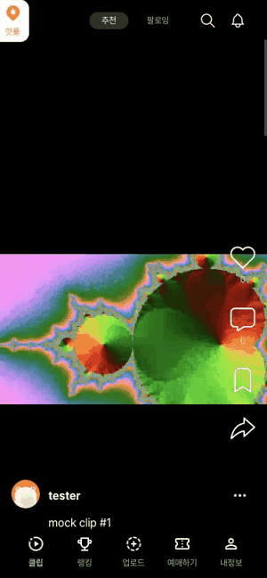
</p>

> 2025.06 – 2025.08 · 3인 팀 · Front Engineer  
> 아래 화면 캡처는 백엔드 없이 로컬 목 데이터로 찍은 것이라 영상은 테스트용 클립입니다.

---

## 화면

| 로그인 | 온보딩 튜토리얼 | 취향 선택 |
| :---: | :---: | :---: |
| 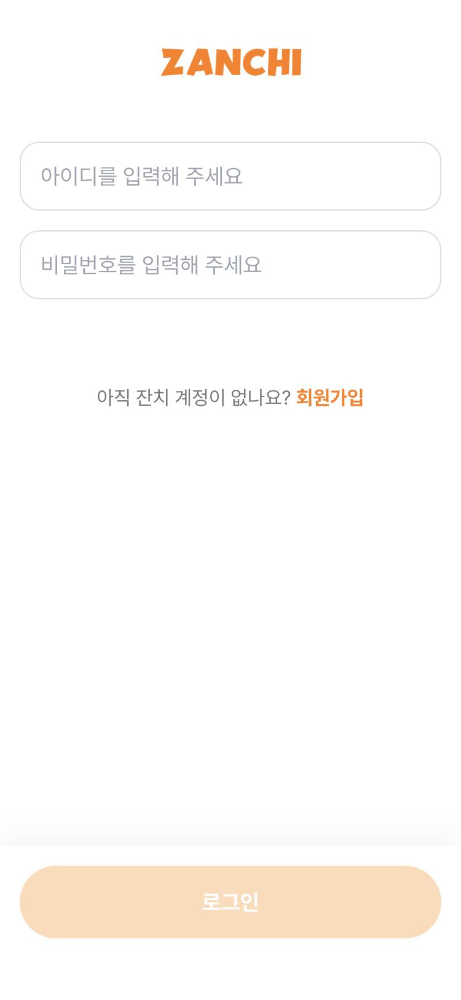 | 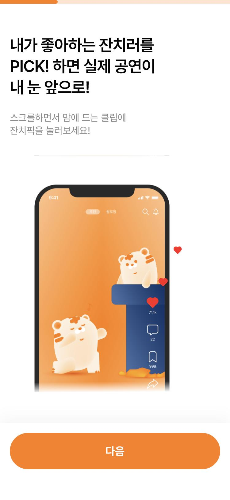 | 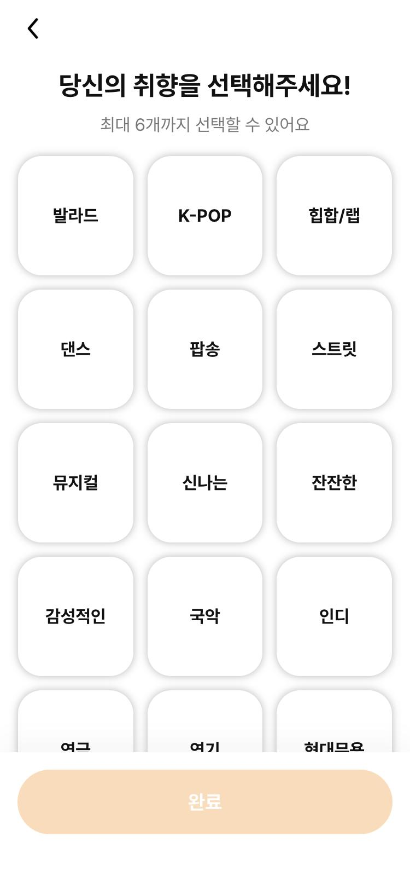 |

| 숏폼 피드 | 핫플루트 | 알림 | 결제 |
| :---: | :---: | :---: | :---: |
| 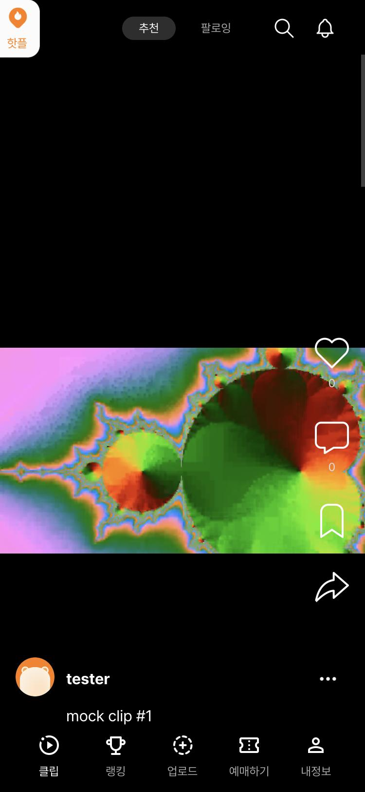 | 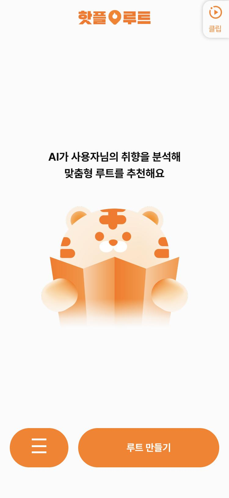 | 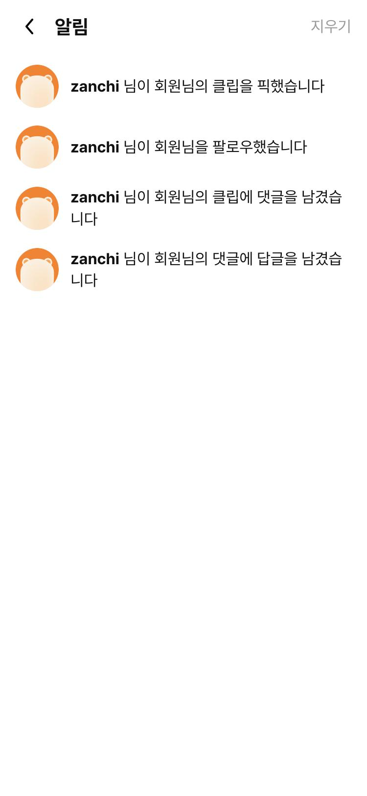 | 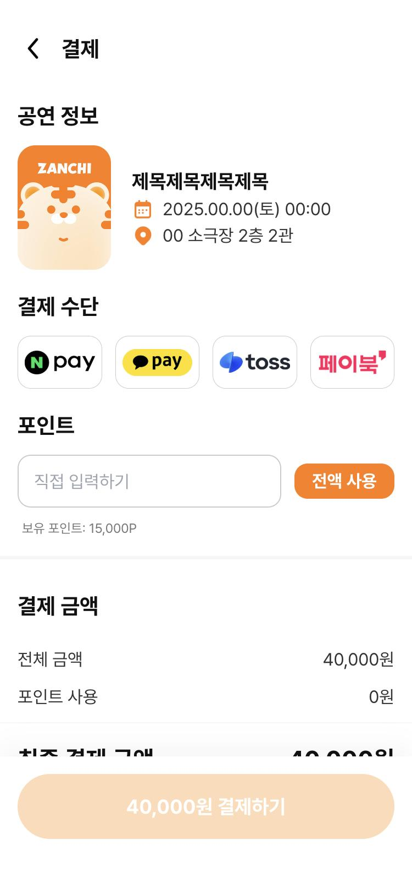 |

---

## 주요 기능

- **숏폼 피드** — 한 화면에 영상 하나가 정확히 멈추는 scroll-snap 세로 피드, 자동 재생, 무한 스크롤
- **HLS 재생** — 로그인 사용자만 볼 수 있는 영상을 Chrome·Firefox·Safari 전 브라우저에서 재생
- **잔치픽 · 저장 · 댓글** — 좋아요/저장 Optimistic UI, 2-depth 댓글 바텀시트
- **핫플루트** — AI가 취향을 분석해 공연·소극장 루트 추천
- **예매 · 결제** — 공연 선택부터 포인트 사용, 결제까지
- **온보딩** — 튜토리얼, 취향(장르) 선택으로 개인화 피드 시작
- **검색 · 랭킹 · 알림 · 프로필 · 업로드**

---

## 기술적으로 집중한 부분

### 1. 브라우저별로 다른 HLS 인증 제약 해결

HLS 영상은 목차(`.m3u8`)와 수십 개의 조각(`.ts`)으로 나뉘어 전송되는데, 조각 하나하나에 인증을 실어야 했습니다.
브라우저마다 재생 방식이 달라 3단계 폴백으로 풀었습니다.

| Tier | 환경 | 인증 방법 |
| --- | --- | --- |
| 1 | Chrome · Firefox (`Hls.isSupported()`) | hls.js `xhrSetup`으로 세그먼트 요청마다 Bearer 헤더 주입 |
| 2 | Safari (네이티브 HLS) | 헤더 주입 불가 → `withCredentials` 쿠키 폴백 |
| 3 | MP4 | 인증 fetch 후 blob URL로 변환해 재생 |

→ 백엔드 변경 없이 전 브라우저에서 인증된 영상 재생. 코드: [`HlsPlayer.js`](app/clip/_components/HlsPlayer.js)

### 2. 무한 피드 리소스 상한 잡기 — 윈도잉 + tier 생명주기 + cleanup 파이프라인

세로 무한 피드는 스크롤할수록 hls.js 인스턴스, 진행 중 다운로드, blob URL, `<video>` DOM이 쌓입니다.
이것들은 GC가 치워 주지 않아서, 스크롤 위치로 계산한 **현재 인덱스 하나**에서 모든 것을 파생시켰습니다.

<p align="center">
  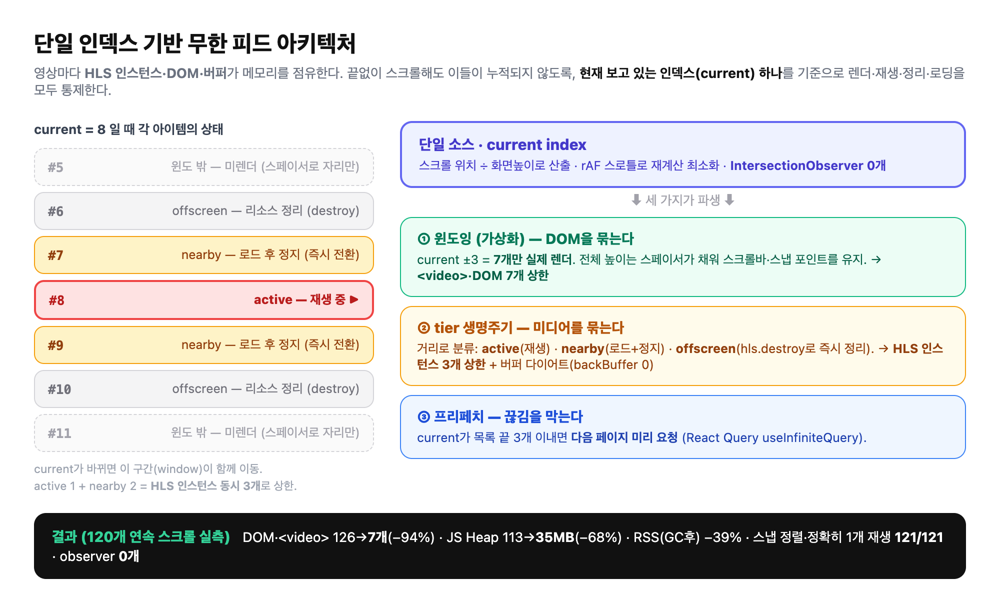
</p>

- **윈도잉** — 전체 높이 스페이서로 스냅 포인트를 유지하면서 현재 ±3(최대 7개)만 렌더
- **tier** — 거리 0은 재생, ±1은 인스턴스 유지(즉시 재개), 그 밖은 `cleanupAll()`
- **cleanupAll** — `hls.destroy()` · `AbortController.abort()` · `URL.revokeObjectURL()` · `video.load()` 리셋을 offscreen 진입 · 언마운트 · src 교체 세 경로에서 호출
- **버퍼 다이어트** — 숏폼에 맞춰 `backBufferLength: 0`, `maxBufferLength: 10`, `maxBufferSize: 6MB`

코드: [`FeedList.js`](app/clip/_components/FeedList.js), [`HlsPlayer.js`](app/clip/_components/HlsPlayer.js)

#### 실측 결과

같은 피드를 40회 스크롤한 직후, cleanup 미적용과 적용 상태를 비교한 캡처입니다.

<p align="center">
  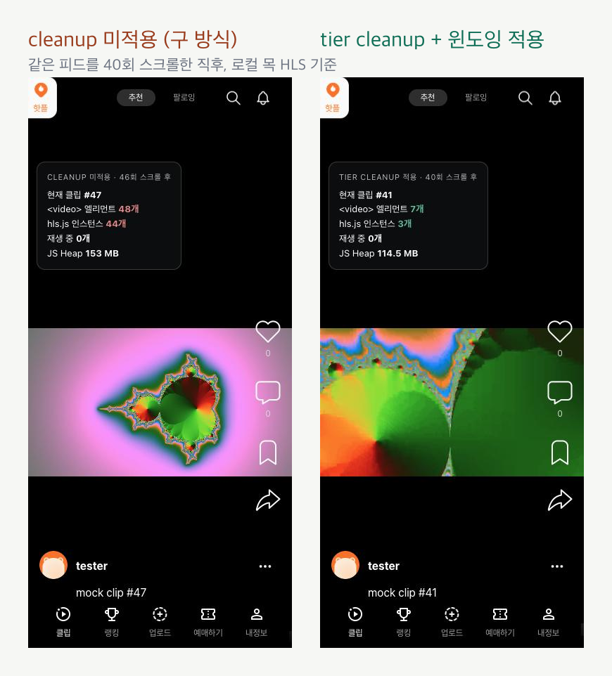
</p>

| 지표 (헤드리스 Chrome, 720p HLS) | 적용 전 | 적용 후 |
| --- | --- | --- |
| 동시 hls.js 인스턴스 (45 스크롤) | 43개, 계속 증가 | **6개 상한** |
| 렌더러 RSS, GC 후 | 689 MB | **470 MB** (−32%) |
| `<video>` 엘리먼트 (120 스크롤, 윈도잉) | 126개, 계속 증가 | **7개 상한** (−94%) |
| JS Heap 피크 (120 스크롤, 윈도잉) | 112.9 MB | **35.6 MB** (−68%) |
| 스냅 정렬 · 정확히 1개 재생 | 121/121 | 121/121 |

<details>
<summary>측정 차트 보기</summary>

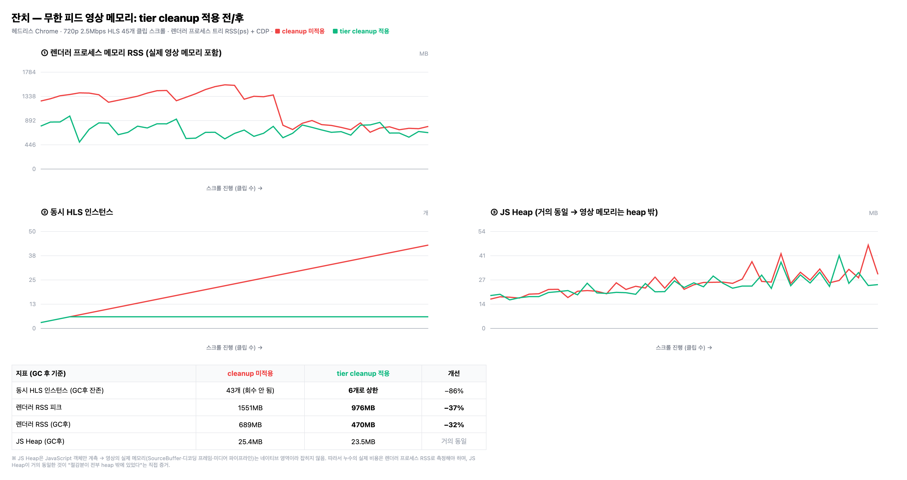
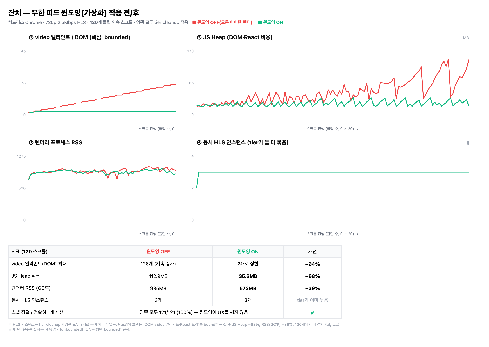

</details>

### 3. 그 밖에

- **IntersectionObserver 역할 분리** → 이후 고정 높이를 이용해 인덱스 기반으로 단순화, observer 0개
- **영상 이어보기** — `sessionStorage`에 500ms 간격 저장, 2초 이내 재진입 시 이어보기
- **댓글 시트** — 열었다 닫는 임시 UI라 React Query 대신 `useState`로 수명 일치, 답글은 "답글 보기"에서만 로드
- **API 정규화 레이어** — 백엔드 스키마 변경을 한 곳에서 흡수
- **클라이언트/서버 상태 분리** — UI·인증·업로드 임시 파일은 Recoil, 피드·랭킹·프로필은 React Query

---

## 기술 스택

| 분류 | 사용 |
| --- | --- |
| Framework | Next.js 14 (App Router), React 18 |
| 영상 | hls.js |
| 서버 상태 | @tanstack/react-query 5 |
| 클라이언트 상태 | Recoil |
| 스타일 | styled-components, Tailwind CSS |
| 네트워크 | Axios (인터셉터 기반 인증 자동 주입) |
| 배포 | Vercel |

---

## 프로젝트 구조

```text
app/
├── _api/            # 도메인별 API 호출 + 응답 정규화 (clips, comments, likes, ranking, …)
├── _components/     # BottomNav, BottomSheet, PrimaryButton, QueryErrorBoundary
├── _state/          # Recoil atoms
├── clip/            # 숏폼 피드 (FeedList, FeedItem, HlsPlayer, 댓글 시트)
├── hotplroute/      # AI 루트 추천
├── onboarding/      # welcome · tutorial · interests
├── ranking/ search/ notifications/ profile/ upload/ ticket/ payment/
└── providers.js     # React Query · Recoil Provider
```

---

## 실행

```bash
npm install
npm run dev
# http://localhost:3000
```

환경 변수 `NEXT_PUBLIC_API_BASE`로 API 주소를 지정합니다. 지정하지 않으면 기본 서버를 바라봅니다.
